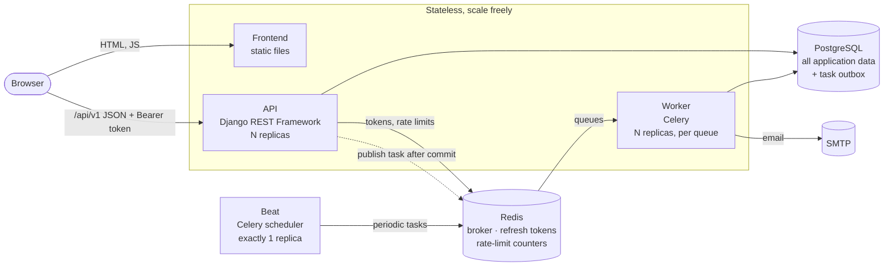

# Architecture

OpsDesk is four independently runnable processes that share only PostgreSQL and Redis.
Each one reads all of its configuration from environment variables, keeps no state on local
disk that matters, and can be started, stopped and scaled on its own.

## Components

| Component | Code | Process | Scaling | Talks to |
| --- | --- | --- | --- | --- |
| Frontend | `frontend/` | Static files from `npm run build` | Any number; it's just files | API (from the browser) |
| API | `backend/` | `gunicorn config.wsgi` (or `manage.py runserver` locally) | Any number of replicas | PostgreSQL, Redis |
| Worker | `backend/` | `celery -A config worker -Q notifications,sla,reports` | Any number; can be split per queue | PostgreSQL, Redis, SMTP |
| Beat | `backend/` | `celery -A config beat` | **Exactly one** | Redis |

The API, worker and Beat share one Python codebase and dependency base
(`requirements/api.txt` and `requirements/worker.txt` both build on `base.txt`) but are
separate processes with separate entry points.

## Why each process can be replicated

**API.** Nothing is kept in process memory between requests.

- Authentication is a signed JWT access token (verified with the shared `JWT_SIGNING_KEY`,
  issuer and audience), so any replica can verify any request.
- Refresh tokens are tracked in Redis, so sign-out and rotation are seen by every replica at
  once.
- Rate-limit counters live in the Redis cache (`CACHE_URL`), so limits are global, not per
  replica.
- Background work is handed to Celery through the database outbox; the API never runs it.

**Worker.** Tasks are idempotent and claim their work with database locks or conditional
updates, so two workers can receive the same task (redelivery after a crash, or a sweep
re-publishing a message) and only one side effect happens. See
[background-processing.md](background-processing.md).

**Beat.** Must run as a single replica; two schedulers would publish every periodic task
twice. The tasks themselves are idempotent, so a brief overlap during a restart is harmless,
but steady-state duplication would waste work.

**Frontend.** A static bundle. The API URL is either compiled in (`VITE_API_BASE_URL`) or
supplied at runtime by replacing `config.js`, so one build can be promoted through every
environment.

## Request path

1. The browser loads the SPA, then calls `POST /api/v1/auth/token/refresh/`. The httpOnly
   refresh cookie (scoped to `/api/v1/auth/`) restores the session without a password.
2. The SPA keeps the 15-minute access token in memory and sends it as `Authorization: Bearer`.
3. The API checks the token, the role-based permission for the view, then runs the change in
   one database transaction through `apps/incidents/services.py`: lock the row, apply the
   change, append an `IncidentEvent`, and write an `OutboxMessage` for any follow-up work.
4. After the transaction commits, the outbox message is published to Redis. If Redis is down
   the request still succeeds and the Beat sweep publishes it later.
5. A worker picks up the task and creates in-app notifications and emails.

## Failure behaviour

| What fails | API | Worker / Beat |
| --- | --- | --- |
| PostgreSQL | `/health/ready` returns 503 so traffic is routed elsewhere; requests fail | Tasks retry with backoff (`OperationalError` is transient) |
| Redis | Requests with a valid access token keep working. Sign-in, refresh and sign-out return 503. New background work waits in the outbox. Rate limiting fails open. | Workers reconnect; queued tasks are not lost (acks are late) |
| SMTP | Unaffected | Email deliveries retry with backoff, then are marked failed; in-app notifications are unaffected |
| A worker dies mid-task | Unaffected | The task is redelivered (`acks_late`, `reject_on_worker_lost`) and its idempotency checks prevent a double side effect |

## Health checks

| Endpoint / command | Meaning | Use as |
| --- | --- | --- |
| `GET /health/live` | The API process is up. Touches nothing else. | Liveness |
| `GET /health/ready` | PostgreSQL answers (required). Redis is reported but not required, since most requests don't need it. 503 when not ready. | Readiness |
| `python -m opsdesk_tasks.healthcheck worker --max-age 60` | The worker's heartbeat file is fresh (written every `WORKER_HEARTBEAT_INTERVAL` seconds by a Celery bootstep). Exit code 0 or 1. | Worker liveness |
| `python -m opsdesk_tasks.healthcheck beat --max-age 120` | Beat's scheduler ticked recently. | Beat liveness |

## Security

- **Roles** (Admin, Engineer, Viewer) are enforced by DRF permission classes on every view;
  the frontend only hides controls. See [api.md](api.md) for the matrix.
- **Tokens.** The access token lives only in browser memory. The refresh token is an httpOnly,
  `SameSite=Lax` cookie (and `Secure` outside local development) restricted to
  `/api/v1/auth/`. Refresh tokens rotate on every use; reusing an old one is refused. Changing
  a user's role, deactivating them or changing a password revokes all their refresh tokens.
- **Rate limits** on sign-in (per IP and per account), refresh, registration and password
  change, shared across replicas. Configure `NUM_PROXIES` when behind a load balancer or
  ingress so the real client IP is used.
- **Headers.** Every API response carries `Content-Security-Policy: default-src 'none'`,
  `X-Content-Type-Options: nosniff`, `X-Frame-Options: DENY`, `Referrer-Policy`,
  `Cross-Origin-Opener-Policy`, `Permissions-Policy` and `Cache-Control: no-store`.
  Production adds HSTS (`SECURE_HSTS_SECONDS`) and can redirect to HTTPS.
- **Secrets** come only from the environment. `.env.example` files hold placeholders; real
  `.env` files are git-ignored.
- **Passwords** are hashed with Argon2 and checked against Django's password validators.

## Configuration

All settings are environment variables, documented with defaults in
[`backend/.env.example`](../backend/.env.example) and
[`frontend/.env.example`](../frontend/.env.example). Settings modules:
`config.settings.dev` (reads `backend/.env`), `config.settings.test` and
`config.settings.prod` (requires every secret, no insecure defaults).

Values that **must be identical on every API replica**: `DJANGO_SECRET_KEY`,
`JWT_SIGNING_KEY`, `JWT_ISSUER`, `JWT_AUDIENCE`, `REDIS_URL`, `CACHE_URL`, `DATABASE_URL`.

## Related documents

- [database.md](database.md): tables, constraints and how concurrency is handled
- [api.md](api.md): endpoints, conventions, errors and permissions
- [background-processing.md](background-processing.md): tasks, queues, retries and idempotency
