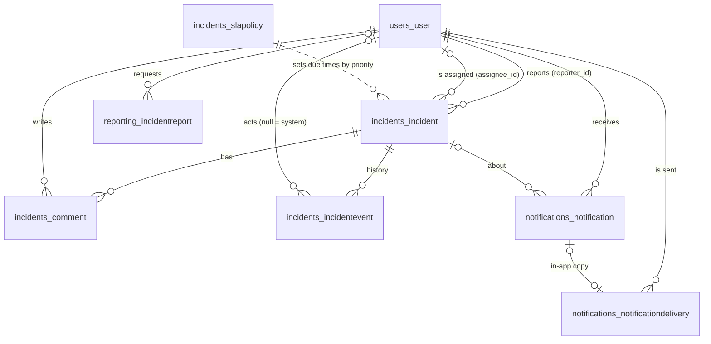
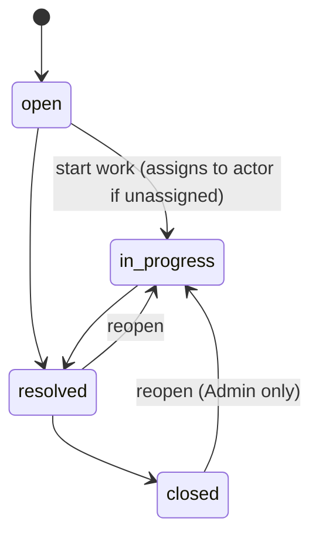

# Database

PostgreSQL holds all application data, including the task outbox. Redis holds only data
that can be lost or rebuilt: the Celery broker, refresh-token state and rate-limit counters.

Schema changes are Django migrations in each app's `migrations/` folder. Run them once per
release (`python manage.py migrate`) before new API or worker processes start: never from
every replica at boot.

## Entity relationships

`opsdesk_tasks_outboxmessage` stands alone: it references tasks by name and payload, not by
foreign key.

## Tables

### `users_user`

Custom user model keyed by email.

| Column | Type | Notes |
| --- | --- | --- |
| `email` | varchar, unique | Sign-in name |
| `full_name` | varchar | |
| `role` | varchar | `admin`, `engineer` or `viewer` |
| `is_active` | bool | Inactive users can't sign in or be assigned |
| `password` | varchar | Argon2 hash |

Index on (`role`, `is_active`) for "assignable users" and the per-engineer dashboard.
Users are never hard-deleted while they have incidents or comments (`PROTECT`); deactivate
them instead.

### `incidents_incident`

| Column | Type | Notes |
| --- | --- | --- |
| `reference` | varchar, unique, nullable | `INC-000042`, set from the id right after insert |
| `title`, `description` | text | |
| `priority` | varchar | `critical`, `high`, `medium`, `low` |
| `status` | varchar | `open`, `in_progress`, `resolved`, `closed` |
| `sla_status` | varchar | `ok`, `at_risk`, `breached` (maintained by the SLA task) |
| `reporter_id` | FK user, `PROTECT` | |
| `assignee_id` | FK user, nullable, `SET_NULL` | |
| `response_due_at`, `resolve_due_at` | timestamptz, nullable | From the SLA policy at creation or priority change |
| `acknowledged_at` | timestamptz | First move to In progress; meets the response target |
| `resolved_at`, `closed_at` | timestamptz | Cleared on reopen |
| `response_breached_at`, `resolution_breached_at` | timestamptz | Set once; makes breach handling idempotent |
| `last_reminded_at` | timestamptz | Claims a reminder window; prevents duplicate reminders |
| `created_at`, `updated_at` | timestamptz | |

Indexes: (`status`, `priority`), (`assignee_id`, `status`), (`sla_status`), (`created_at`).
These back the default list ("active, newest first"), "assigned to me", the SLA sweep and the
dashboard.

Status transitions are enforced in `apps/incidents/services.py`:

### `incidents_comment`

`incident_id` (`CASCADE`), `author_id` (`PROTECT`), `body`, `created_at`, `edited_at`.
Index on (`incident_id`, `created_at`). Only the author or an Admin can edit or delete.

### `incidents_incidentevent`

Append-only history: `incident_id` (`CASCADE`), `actor_id` (nullable; null means the system,
e.g. an SLA breach), `event_type`, `data` (JSON), `created_at`. Index on
(`incident_id`, `created_at`). Rows are written in the same transaction as the change they
describe, so history never disagrees with state.

| `event_type` | `data` |
| --- | --- |
| `created` | `priority`, `title` |
| `updated` | `fields`: `{field: {from, to}}` (description records only `changed: true`) |
| `priority_changed` | `from`, `to` |
| `assigned`, `unassigned` | `from`, `to`: `{id, email}` or null |
| `status_changed` | `from`, `to`, `note` |
| `comment_added`, `comment_edited`, `comment_deleted` | `comment_id` |
| `sla_breached` | `target` (`response` or `resolution`), `due_at` |
| `reminder_sent` | `interval_minutes`, `window_start` |

### `incidents_slapolicy`

One row per priority (primary key `priority`): `response_minutes`, `resolution_minutes`,
`reminder_interval_minutes` (null = no reminders), `updated_at`. Seeded by migration
`incidents/0002` with: critical 15 min / 4 h / every 30 min; high 1 h / 8 h / every 1 h;
medium 4 h / 1 day / none; low 1 day / 3 days / none.

### `notifications_notification`

In-app notifications: `recipient_id`, `incident_id` (nullable), `kind`, `title`, `body`,
`read_at`, `created_at`. Index on (`recipient_id`, `read_at`) for the unread count.

### `notifications_notificationdelivery`

One row per (event, recipient, channel), the unit of idempotency for notifications.

| Column | Notes |
| --- | --- |
| `dedupe_key` | Unique. `event:{event_id}:user:{user_id}:{channel}` (or `report:{id}:…`). A second attempt to create the same delivery hits this constraint and is skipped. |
| `channel` | `in_app` or `email` |
| `status` | `pending`, `sent`, `failed`, `skipped` (recipient deactivated) |
| `attempts`, `last_error` | Retry bookkeeping |
| `notification_id` | The in-app row this delivery produced |

Index on (`status`, `created_at`).

### `reporting_incidentreport`

`kind` (`daily`, `weekly`, `adhoc`), `period_start`, `period_end` (exclusive), `status`
(`pending`, `completed`, `failed`), `data` (JSON figures), `error`, `requested_by_id`,
`created_at`, `completed_at`.

Constraints: unique (`kind`, `period_start`, `period_end`), so a period's report exists at
most once however many times it's scheduled or requested; and a check that
`period_end > period_start`.

### `opsdesk_tasks_outboxmessage`

`task_name`, `payload` (JSON kwargs), `status` (`pending`, `sent`), `attempts`,
`last_error`, `created_at`, `dispatched_at`. Index on (`status`, `created_at`) for the sweep.
See [background-processing.md](background-processing.md#the-outbox).

## Concurrency and consistency

- **One transaction per change.** Every write in `apps/incidents/services.py` is wrapped in
  `transaction.atomic` and starts with `SELECT … FOR UPDATE` on the incident, so two
  replicas changing the same incident serialise instead of overwriting each other.
- **History and side effects commit with the change.** The `IncidentEvent` and the
  `OutboxMessage` are inserted in the same transaction. If it rolls back, neither exists.
- **Conditional updates for background claims.** The SLA task flags a breach with
  `UPDATE … WHERE response_breached_at IS NULL`, and reminders claim a window with
  `UPDATE … WHERE last_reminded_at <= now - interval` (or, if never reminded, the
  incident is older than one interval). Only the
  worker whose update changes a row goes on to notify.
- **Unique constraints as the last line of defence.** `dedupe_key` and the report period
  constraint make duplicate side effects impossible even if two workers race past the
  application checks.
- **`SKIP LOCKED` for the outbox sweep**, so concurrent sweeps share pending rows instead of
  blocking or double-publishing.

## Connections

`DB_CONN_MAX_AGE` (default 60 s) keeps connections open between requests; budget roughly
`replicas × gunicorn workers` for the API plus `replicas × CELERY_WORKER_CONCURRENCY` for
workers against PostgreSQL's `max_connections`, or put a pooler such as PgBouncer in front.
`DB_CONNECT_TIMEOUT` bounds how long a request waits for a connection when the database is
unreachable.
